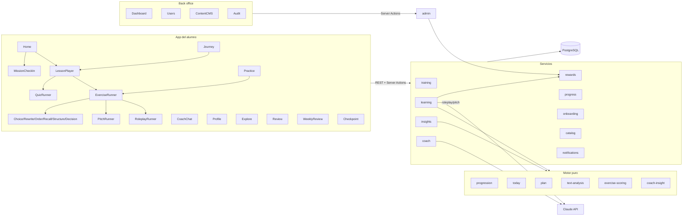
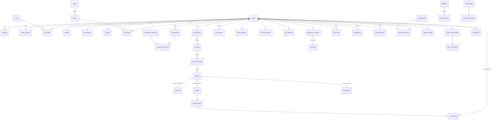

# Personal Growth OS — Arquitectura y diseño técnico

> Entregables previos al desarrollo (sección 39 del brief). El código es la fuente de verdad; este documento explica el *porqué* y el mapa.

**Principio rector:** cada pantalla debe ayudar a mejorar una habilidad. El producto implementa el ciclo **LEARN → PRACTICE → APPLY → REFLECT → IMPROVE → volver mañana**, con *una idea poderosa por día*.

---

## 1. Arquitectura general

```
┌───────────────────────── Cliente (navegador / PWA instalada) ─────────────────────────┐
│  React 19 · Next.js App Router · Tailwind v4 · mobile-first 390×844                   │
│  Service Worker (shell + última lección offline) · cola offline (localStorage)        │
└──────────────┬────────────────────────────────────────────────────┬───────────────────┘
               │ RSC / Server Actions (formularios)                 │ REST JSON (/api/*)
┌──────────────▼────────────────────────────────────────────────────▼───────────────────┐
│ Next.js (Node runtime)                                                                 │
│  proxy.ts → gate optimista por cookie                                                  │
│  Capa de acceso (src/server/auth): sesión opaca hasheada, RBAC, rate limit, CSRF      │
│  Servicios de dominio (src/server/services): training, learning, rewards, progress,    │
│     insights, coach, onboarding, catalog, admin, notifications                         │
│  Motor puro (src/server/engine): progression, today, plan, text-analysis,             │
│     exercise-scoring, coach-insight, client-config  ← sin I/O, 100 % testeable          │
│  IA (src/server/ai): Claude (coach streaming, simulador, evaluación estructurada)      │
└──────────────┬───────────────────────────────────────────────────────┬───────────────┘
               │ Drizzle ORM                                           │ HTTPS
┌──────────────▼───────────────┐                           ┌───────────▼──────────────┐
│ PostgreSQL                    │                           │ Anthropic API (opcional)  │
│  · Neon (prod, pooled + direct│                           │ Resend (email, opcional)  │
│    para migraciones)          │                           │ Google OAuth (opcional)   │
│  · PGlite (dev/tests, WASM)   │                           └───────────────────────────┘
└───────────────────────────────┘
```

Decisiones clave (ADR resumidos):

| Decisión | Motivo |
|---|---|
| Next.js 16 con `cacheComponents: false` | Toda pantalla es personalizada y depende de la sesión; el modelo de Cache Components obligaría a envolver cada lectura de sesión en Suspense sin beneficio real. |
| Drizzle ORM | Tipado fuerte desde el esquema, migraciones SQL versionadas (`drizzle/`), cero runtime pesado, funciona igual con `pg` (Neon) y PGlite. |
| `pg` (node-postgres) contra Neon *pooled* | Recomendación de Neon para servidores Node/Vercel Fluid; las migraciones usan `DATABASE_URL_UNPOOLED` (PgBouncer no soporta sentencias de sesión). |
| PGlite en local y tests | Postgres real en WASM: el proyecto arranca sin instalar nada y los tests de integración corren contra SQL real (no mocks). En producción es imposible usarlo por accidente (`DATABASE_URL` obligatorio). |
| Auth propia (no librería) | Control total sobre el modelo `users/sessions/roles` del brief; tokens opacos de 256 bits, solo el SHA-256 se guarda; scrypt para contraseñas; Arctic solo para el protocolo OAuth de Google. |
| Motor determinista + IA opcional | Feedback, coach "playbook" y simulador guionizado funcionan sin proveedor; con `ANTHROPIC_API_KEY` la IA se superpone (nunca sustituye las señales medibles). |
| REST `/api/*` para el reproductor | Las escrituras del ciclo diario son idempotentes y reproducibles: permiten la cola offline y servirán tal cual a apps iOS/Android (aceptan `Authorization: Bearer`). |

## 2. Diagrama de componentes



## 3. ERD (núcleo)



Tablas adicionales a las del brief, y por qué:
`oauth_accounts`, `password_reset_tokens`, `rate_limits` (seguridad), `growth_plans` (el plan personalizado es una entidad versionable), `user_journeys` (múltiples programas por usuario), `review_items` (motor de repaso espaciado), `weekly_reviews`, `analytics_events`.

## 4. Schema PostgreSQL

- Fuente: [`src/server/db/schema.ts`](../src/server/db/schema.ts) (comentado por secciones).
- SQL generado: [`drizzle/0000_init.sql`](../drizzle/0000_init.sql).
- Invariantes garantizados por la base de datos (no solo por código):
  - email único sin distinguir mayúsculas (`unique index on lower(email)`).
  - XP idempotente: `unique (user_id, idempotency_key)` en `xp_transactions` — una lección/misión/review nunca paga dos veces, incluso con doble clic o reintentos offline.
  - un intento de misión por usuario y acción, un progreso por usuario y lección, un repaso por usuario y concepto, una notificación por usuario y día (`dedupe_key`).
  - enums para estados (`content_status`, `action_status`, …) y `ON DELETE CASCADE` desde `users`.
- JSONB tipado para contenido flexible: `lessons.content`, `exercises.config` (unión discriminada por `type`), `exercise_attempts.feedback`.

## 5. Estructura de carpetas

```
src/
  app/
    (auth)/            login, register, forgot/reset password + server actions
    onboarding/        diagnóstico (wizard) + revelación del plan
    (app)/(tabs)/      home, journey, practice, explore, profile  ← con navegación inferior
    (app)/(focus)/     lesson, mission, review, review/week, checkpoint, practice/[slug],
                       explore/[slug], coach, settings  ← pantallas de una sola tarea
    admin/             dashboard, users, content (journeys/modules/lessons/resources/practice), audit
    api/               REST del ciclo diario, coach (streaming), auth/google, cron
    manifest.ts, icons/, offline/   PWA
  components/          ui/ (primitivas), exercises/ (runners + feedback), pwa/, navegación
  lib/                 dates (zona horaria), taxonomy, api-client (cola offline), cn
  server/
    auth/              crypto, sessions, current-user (DAL), rbac, rate-limit, google
    db/                schema, types (JSON), migrate, seed/ (+ contenido original)
    engine/            lógica pura
    services/          lógica con base de datos
    ai/                cliente Claude, evaluación, simulador
    validation/        zod
  proxy.ts
drizzle/               migraciones SQL
scripts/               db.ts (migrate/seed/grant), e2e-server.mjs
tests/                 unit/, integration/ (PGlite), e2e/ (Playwright 390×844)
public/sw.js           service worker
```

## 6. User flows

1. **Alta:** Landing → Register (o Google) → Onboarding (≈15 pantallas de un toque, 2–3 min) → *Plan reveal* → Home.
2. **Día de entrenamiento:** Home → *Start today's training* → Hook → Why it matters → Core concept → Expert insight → Example → Ejercicio interactivo (feedback inmediato) → Misión real (“I'll do it today”) → Reflexión → Knowledge check (corrección por pregunta) → Completion (XP, streak, skill, logros, mañana) → Home (“done” + misión viva).
3. **Aplicar y reflexionar:** Home → *I did it — check in* → Did you do it? (Yes / Not yet) → 😞😐🙂🔥 → 4 preguntas de reflexión → *Mission logged*. Si es de un día anterior aparece arriba: “Did you do it?”.
4. **Volver mañana:** la siguiente lección se desbloquea a medianoche **en la zona horaria del alumno**; los conceptos del quiz reaparecen a 1/3/7/14/30 días en *Review*.
5. **Practicar:** Practice → herramienta (simulador de conversación/networking, presentation trainer, organizador de ideas, story builder, decisión, memoria, hedge hunter) → feedback por dimensiones.
6. **Coach:** Home “Ask your coach” → chat con contexto personal (plan, habilidades, misiones, reflexiones).
7. **Revisiones:** semanal (cada 7 días: estadísticas + “What changed this week?” + foco siguiente) y checkpoints día 30/60/90 (*Before → Now*).
8. **Admin:** Dashboard → Users (roles/suspender) → Content (journey → module → lesson con ejercicio/quiz/misión; Draft→Review→Published→Archived) → Audit.

## 7. API specification (REST)

Todas responden JSON `{…}` o `{ error }` con el código HTTP adecuado; requieren sesión (cookie o `Authorization: Bearer <token>`) y onboarding completo; las escrituras con cookie exigen mismo origen.

| Método y ruta | Cuerpo | Respuesta |
|---|---|---|
| `POST /api/lessons/:id/progress` | `{ step, seconds }` | `{ ok }` — idempotente, encolable offline |
| `POST /api/lessons/:id/complete` | `{ reflection? }` | `{ alreadyCompleted, reward, missionAttemptId, nextLesson, journeyCompleted }` |
| `POST /api/exercises/:id/attempts` | `{ response, durationSeconds }` | `{ attemptId, feedback, reveal, reward }` (puntuado en servidor) |
| `POST /api/quizzes/:id/check` | `{ questionId, answer }` | `{ correct, correctIndex, explanation }` |
| `POST /api/quizzes/:id/attempts` | `{ answers[] }` | `{ score, total, results, reward }` (+ alta en repaso espaciado) |
| `POST /api/missions/:attemptId/checkin` | `{ status: done\|not_yet\|skipped, outcome? }` | `{ status, reward }` |
| `POST /api/missions/:attemptId/reflection` | `{ whatHappened, whatWorked, whatToImprove, whatLearned }` | `{ reward }` |
| `POST /api/reviews/:itemId` | `{ answer }` | `{ correct, explanation, nextDueOn, reward }` |
| `POST /api/practice/:exerciseId/turn` | `{ turns[] }` | `{ reply, done, mode: ai\|scripted }` |
| `POST /api/coach/messages` | `{ conversationId?, message }` | `text/plain` en streaming; cabeceras `X-Conversation-Id`, `X-Coach-Mode` |
| `GET /api/auth/google` · `/callback` | — | OAuth 2.0 + PKCE + state |
| `GET /api/cron/notifications` | `Authorization: Bearer $CRON_SECRET` | `{ checked, created }` |

`reward` = `{ awarded, xp, totalXp, streak{current,longest,event}, levelUp, skill, achievements[] }`.
Formularios (auth, onboarding, ajustes, revisiones, CMS) usan Server Actions con validación zod y protección de origen nativa de Next.

## 8. Estrategia de autenticación

- **Email/contraseña:** scrypt (N=2¹⁵, r=8, p=1, sal de 16 B), comparación en tiempo constante, hash ficticio para no filtrar qué emails existen. Política NIST: ≥10 caracteres, sin reglas de composición.
- **Sesiones:** token aleatorio de 256 bits en cookie `__Host-pgos_session` (HttpOnly, Secure, SameSite=Lax, Path=/). En BD solo se guarda `sha256(token)`; 30 días con renovación deslizante; se invalidan al suspender la cuenta o resetear la contraseña.
- **Google:** OAuth 2.0 con PKCE y `state` en cookies de 10 min; solo se enlaza a una cuenta existente si Google afirma `email_verified` (evita *account takeover*).
- **Recuperación:** token de un solo uso (hash en BD), 1 h de validez, respuesta idéntica exista o no la cuenta, rate-limit por IP y por email; al usarlo se queman todos los tokens pendientes y se cierran todas las sesiones.
- **Protección de rutas:** `proxy.ts` hace un *gate* optimista por cookie; la autorización real ocurre en la capa de acceso a datos (`requireUser`, `requirePermission`) en cada request.
- **Clientes nativos:** el mismo token vale como `Bearer`; las peticiones Bearer no son vulnerables a CSRF y el token explícito prevalece sobre la cookie.

## 9. Estrategia RBAC

Roles en BD (`roles`, `user_roles`); permisos en código ([`src/server/auth/rbac.ts`](../src/server/auth/rbac.ts)) para que cada cambio de permisos se revise como código.

| Permiso | SUPER_ADMIN | ADMIN | CONTENT_MANAGER | COACH | USER |
|---|:-:|:-:|:-:|:-:|:-:|
| admin:access | ✓ | ✓ | ✓ | ✓ | |
| metrics:read | ✓ | ✓ | | ✓ | |
| users:read | ✓ | ✓ | | ✓ | |
| users:manage (suspender, roles no-admin) | ✓ | ✓ | | | |
| roles:grant_admin | ✓ | | | | |
| content:read / content:write | ✓ | ✓ | ✓ | | |
| content:publish (publicar/archivar) | ✓ | ✓ | | | |
| audit:read | ✓ | ✓ | | | |

Reglas extra: nadie cambia sus propios roles ni se suspende a sí mismo; un ADMIN no puede tocar cuentas con roles superiores; siempre queda al menos un SUPER_ADMIN activo; los alumnos (USER) solo acceden a sus propios datos — **todas** las consultas del alumno filtran por `user_id` de la sesión (verificado en tests de integración). Las rutas de admin responden 404 a quien no tiene permiso (no revelan su existencia). Bootstrap: `SUPER_ADMIN_EMAILS` o `npm run admin:grant -- email ROLE`.

## 10. MVP roadmap (fases ejecutadas)

| Fase | Contenido | Validación |
|---|---|---|
| 1 | Arquitectura, esquema, migraciones, auth (email, Google, reset), sesiones, RBAC, UI base | tests de auth/sesiones/rate-limit |
| 2 | Onboarding diagnóstico, plan personalizado, Home, Journey | integración del ciclo + E2E |
| 3 | Lecciones (10 pasos), 8 tipos de ejercicio, quizzes, misiones, reflexiones | E2E móvil completo |
| 4 | XP, niveles, streak por zona horaria, habilidades, logros, repaso espaciado, revisión semanal, checkpoints 30/60/90 | unit + integración |
| 5 | AI Coach (streaming), simulador de conversación/networking, presentation trainer, feedback IA estructurado | E2E (modo sin IA) |
| 6 | Admin CMS, métricas (DAU/WAU/MAU, retención, funnel), auditoría, notificaciones, PWA, analítica | integración + E2E admin en build de producción |

Preparado para crecer: varias journeys por usuario (`user_journeys`), API REST con Bearer para iOS/Android, roles COACH, contenido versionable por estado, `channel` de notificaciones listo para push, eventos de analítica en BD exportables, y espacio en el modelo para suscripciones (añadir `subscriptions`/`plans` sin tocar el núcleo).

## 11. Componentes UI

Primitivas (`components/ui`): `Button`/`ButtonLink` (5 variantes, 3 tamaños, área táctil ≥44 px), `Card`, `ProgressBar`, `Ring`, `Pill`, `Field`, `TextArea`, `FormAlert`, `EmptyState`, `Eyebrow`, `SectionTitle`.
De producto: `BottomNav`, `SideNav` (desktop), `FocusShell`, `StreakBadge`, `WeekStrip`, `Sparkline`, `MarkdownLite` (render seguro sin HTML), `LessonPlayer`, `QuizRunner`, `ExerciseRunner` → `ChoiceRunner`, `RewriteRunner` (detector de *hedges* en vivo), `OrderRunner`, `RecallRunner`, `StructureRunner`, `DecisionRunner`, `RoleplayRunner`, `PitchRunner`, `FeedbackPanel`, `MissionCheckIn`, `ReviewSession`, `CoachChat`, `OnboardingWizard`, `OfflineSync`, `InstallButton`, `AdminForm`, `ActionButton`.
Sistema visual: papel cálido + tinta, un único acento “ember” reservado para progreso/racha/hoy; tipografía *Instrument Serif* (titulares) + *Geist* (texto); modo oscuro automático; animaciones cortas que respetan `prefers-reduced-motion`.

## 12. Pantallas

Públicas: Landing, Login, Register, Forgot password, Reset password, Offline.
Onboarding: Wizard (intro + 15 preguntas), Plan reveal.
Pestañas: Home, Journey, Practice, Explore, Profile.
Foco: Lesson player (10 pasos + estado bloqueado), Mission check-in, Review (repaso espaciado), Weekly review, Checkpoint 30/60/90, Practice tool, Resource, AI Coach, Settings.
Admin: Dashboard, Users, User detail, Content, Journey, Module, Lesson editor (nuevo/editar), Explore library (lista/nuevo/editar), Practice tools (lista/nuevo/editar), Audit log.

## 13. Riesgos técnicos y mitigaciones

| Riesgo | Mitigación |
|---|---|
| Fechas: la racha/“lección de hoy” dependen del día local | Todo día de entrenamiento se calcula con la zona horaria del perfil y se guarda como `date`; tests cubren Lima vs UTC. |
| Doble premio de XP (doble clic, reintentos, cola offline) | Clave de idempotencia única en BD + transacciones. |
| Filtrar respuestas al cliente | El cliente recibe configs saneadas (sin `quality`, `modelAnswer`, `keywords`; ítems de orden con claves opacas); todo se puntúa en servidor. |
| Coste/latencia de IA | IA opcional y acotada (esfuerzo `low`, timeouts, *rate limit* por usuario), fallback determinista, fallback de rechazo en servidor; la llamada de evaluación ocurre **fuera** de la transacción. |
| PgBouncer en Neon | App con URL *pooled*; migraciones con URL directa. |
| Contenido roto desde el CMS | Esquemas zod completos para configs JSON y estructura de lección; los conceptos de quiz se emparejan por `conceptKey` para no perder el historial de repaso. |
| Notificaciones excesivas | Máximo una por usuario y día (índice único) y solo después de su hora preferida. |
| Cache Components de Next 16 | Desactivado explícitamente (ver ADR); revisar al migrar. |
| PGlite es de un solo proceso | Solo para dev/tests; producción exige `DATABASE_URL`. |

## 14. Plan de testing

- **Unit (Vitest):** fechas/zona horaria, niveles, streak, repaso espaciado, habilidades, desbloqueo diario, análisis de texto, puntuación de los 8 tipos de ejercicio, plan, motor de feedback, RBAC, hashing.
- **Integración (Vitest + PGlite en memoria, migraciones reales + seed):** ciclo diario completo (onboarding → lección → ejercicio → quiz → completar → misión → reflexión → día siguiente → repaso), idempotencia, aislamiento entre usuarios (IDOR), lecciones bloqueadas, cuentas/sesiones/reset/Google/rate limit, CMS y reglas editoriales, gestión de roles, métricas.
- **E2E (Playwright, 390×844):** recorrido completo del alumno, protección de rutas, admin (dashboard, usuarios, edición de lección, validación JSON, alta de journey, auditoría). Se ejecuta en `next dev` o contra el build de producción (`E2E_PROD=1`).
- **Auditoría adversarial:** un agente árbitro independiente revisa seguridad, lógica, UX y diseño en cada ronda; sus hallazgos se corrigen y se re-auditan hasta un veredicto PASS.

Comandos: `npm test` · `npm run test:e2e` · `E2E_PROD=1 npm run test:e2e` (tras `npm run build`) · `npm run typecheck` · `npm run lint`.
